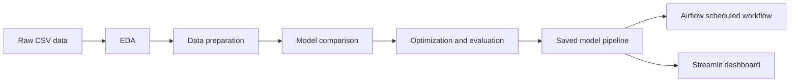
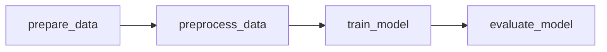

# Student Mental Health Risk Prediction

An end-to-end machine-learning project that predicts a university student's mental-health risk level: **Low**, **Medium**, or **High**. It includes exploratory analysis, data preparation, model comparison, hyperparameter optimization, an Airflow training workflow, and a Streamlit dashboard.

> The project uses a simulated, self-reported dataset. It is a learning project and a screening aid only; it must not be used as a medical diagnosis or as the sole basis for decisions about a student.

## Table of contents

- [Project objective](#project-objective)
- [Dataset](#dataset)
- [Project workflow](#project-workflow)
- [Results](#results)
- [Repository structure](#repository-structure)
- [Installation](#installation)
- [Run the notebooks](#run-the-notebooks)
- [Run Airflow](#run-airflow)
- [Run Streamlit](#run-streamlit)
- [Use the saved model](#use-the-saved-model)
- [Limitations](#limitations)

## Project objective

University students can face academic pressure, financial stress, lack of sleep, social isolation, and lifestyle challenges. The goal is to predict the mental-health risk level of a student from academic, behavioral, lifestyle, and psychosocial information.

The target variable is `Mental_Health_Risk`:

| Class | Meaning |
|---|---|
| `Low` | Lower estimated risk |
| `Medium` | Moderate estimated risk |
| `High` | Higher estimated risk |

This is a multi-class classification problem. The model is evaluated with metrics that give equal importance to each class, especially macro F1-score. Recall for the `High` class is also important because missing a high-risk student could delay support.

## Dataset

The raw dataset is stored at `data/raw/student_mental_health.csv`.

| Property | Value |
|---|---|
| Rows | 2,000 |
| Input features | 16 |
| Target | `Mental_Health_Risk` |
| Classes | Low, Medium, High |
| Missing values | Present in selected numeric and categorical columns |

### Feature groups

| Group | Features |
|---|---|
| Identifier | `Student_ID` |
| Numeric | `Age`, `Year_of_Study`, `Sleep_Hours`, `Study_Hours_Per_Week`, `GPA`, `Social_Media_Hours`, `Screen_Time_Hours`, `Financial_Stress`, `Family_Support`, `Attendance_Rate` |
| Ordered categorical | `Physical_Activity`, `Diet_Quality`, `Part_Time_Job`, `Previous_Mental_Health_History` |
| Nominal categorical | `Gender` |
| Target | `Mental_Health_Risk` |

## Project workflow



### Étape 1 — Exploratory Data Analysis

Notebook: `notebooks/01_exploratory_data_analysis.ipynb`

- Inspected the dataset structure, data types, missing values, duplicate rows, duplicate student IDs, value ranges, and category consistency.
- Examined IQR outliers and feature distributions.
- Analyzed class balance, relationships between features and target, and numerical correlations.

### Étape 2 — Data preparation

Notebook: `notebooks/02_data_preparation.ipynb`

- Removed `Student_ID` from model features.
- Created a stratified 80/20 train/test split.
- Treated inconsistent records where `Social_Media_Hours` is greater than `Screen_Time_Hours` as missing values.
- Applied IQR clipping for selected numeric outliers, using bounds learned from the training data.
- Imputed numeric values with the median and categorical values with the most frequent category.
- Standardized numeric variables.
- Ordinal-encoded ordered categories and one-hot encoded `Gender`.

The classes are almost balanced, so SMOTE and under-sampling are not necessary.

### Étape 3 — Model training and comparison

Notebook: `notebooks/03_model_training_and_comparison.ipynb`

The following models were trained with the same training data:

1. Logistic Regression
2. K-Nearest Neighbors
3. Random Forest

Each model was evaluated with accuracy, macro precision, macro recall, macro F1-score, multiclass ROC-AUC, classification reports, and confusion matrices.

### Étape 4 — Optimization and evaluation

Notebook: `notebooks/04_optimization_and_evaluation.ipynb`

- Selected Logistic Regression and Random Forest as the most promising models from étape 3.
- Used stratified 5-fold cross validation.
- Used `GridSearchCV` for Logistic Regression and `RandomizedSearchCV` for Random Forest.
- Selected the final model using macro F1-score from cross validation.
- Evaluated the selected pipeline once on the independent test set.
- Analyzed misclassified records and documented model limitations.

The full fitted pipeline is saved as `models/mental_health_risk_pipeline.joblib`. It includes consistency checks, IQR clipping, imputation, encoding, scaling, and the final classifier.

### Étape 5 — Airflow and Streamlit

- The Airflow DAG automates data preparation, preprocessing validation, training, and evaluation.
- The Streamlit application shows model performance and makes predictions for new student records.

## Results

The optimized Logistic Regression model was selected.

| Metric on the independent test set | Score |
|---|---:|
| Accuracy | 0.772 |
| Macro precision | 0.774 |
| Macro recall | 0.772 |
| Macro F1-score | 0.773 |
| Macro ROC-AUC, one-vs-rest | 0.918 |
| Recall for High risk | 0.838 |

The model identifies most high-risk students, but the `Medium` class is harder to distinguish from the other two classes. Review the final confusion matrix and classification report in étape 4 before using the model.

## Repository structure

```text
student-mental-health-risk-prediction/
├── app/
│   └── streamlit_app.py                  # Interactive dashboard
├── dag/
│   └── student_mental_health_pipeline.py # Scheduled Airflow workflow
├── data/
│   ├── raw/
│   │   └── student_mental_health.csv
│   └── processed/                        # Created by the workflow
├── models/
│   ├── mental_health_risk_pipeline.joblib
│   ├── model_metrics.json                # Created by the Airflow evaluation task
│   └── confusion_matrix.csv              # Created by the Airflow evaluation task
├── notebooks/
│   ├── 01_exploratory_data_analysis.ipynb
│   ├── 02_data_preparation.ipynb
│   ├── 03_model_training_and_comparison.ipynb
│   └── 04_optimization_and_evaluation.ipynb
├── src/
│   ├── model_workflow.py                 # Reusable workflow functions
│   └── transformers.py                   # Custom scikit-learn transformers
├── requirements.txt
└── README.md
```

## Installation

### Prerequisites

- Python 3.10 or later
- `pip`
- A virtual environment is recommended

From the project root:

```bash
python3 -m venv .venv
source .venv/bin/activate
python -m pip install --upgrade pip
pip install -r requirements.txt
```

On Windows PowerShell, activate the virtual environment with:

```powershell
.venv\Scripts\Activate.ps1
```

### Airflow installation note

For a reproducible Airflow installation, Apache Airflow recommends installing a pinned version with its matching constraints file. If `pip install -r requirements.txt` does not install Airflow correctly, follow the official [Airflow Quick Start](https://airflow.apache.org/docs/apache-airflow/stable/start.html) and use its constraints command for your Python version.

## Run the notebooks

Open the notebooks in VS Code or Jupyter and run them in this order:

1. `01_exploratory_data_analysis.ipynb`
2. `02_data_preparation.ipynb`
3. `03_model_training_and_comparison.ipynb`
4. `04_optimization_and_evaluation.ipynb`

The later notebooks depend on artifacts created by the previous stages. Run cells from top to bottom.

## Run Airflow

The DAG is located at `dag/student_mental_health_pipeline.py` and is scheduled for **every Monday at 02:00**.



| Task | What it does |
|---|---|
| `prepare_data` | Reads raw data and creates the stratified 80/20 split. |
| `preprocess_data` | Validates the incoming training and test data before transformations run in the model pipeline. |
| `train_model` | Tunes Logistic Regression with 5-fold CV and saves the complete pipeline. |
| `evaluate_model` | Evaluates the saved model on test data and saves metrics plus the confusion matrix. |

For local development, configure Airflow to use this repository's DAG folder, then start standalone Airflow:

```bash
export AIRFLOW_HOME="$(pwd)/.airflow"
export AIRFLOW__CORE__DAGS_FOLDER="$(pwd)/dag"
airflow standalone
```

Open `http://localhost:8080`, sign in with the generated admin credentials shown in the terminal, enable `student_mental_health_training`, and trigger it manually. The Airflow UI shows task status, retries, logs, and failures.

The DAG retries a failed task once after five minutes. The task failure callback writes the exception to the Airflow task log.

## Run Streamlit

Run the Airflow DAG once before launching Streamlit. It creates the metrics and confusion-matrix artifacts used by the dashboard.

From the project root:

```bash
streamlit run app/streamlit_app.py
```

The application has two tabs:

- **Model performance:** accuracy, precision, recall, F1-score, ROC-AUC, classification report, metric chart, and confusion matrix.
- **New prediction:** a form for entering a student's features, then displaying predicted risk and class probabilities.

## Use the saved model

The saved pipeline accepts raw feature data, including `Student_ID`, and handles the required preprocessing itself.

```python
import joblib
import pandas as pd

from src import transformers  # Needed so custom pipeline classes can be loaded

model = joblib.load("models/mental_health_risk_pipeline.joblib")

student = pd.DataFrame([{
    "Student_ID": "NEW001",
    "Age": 21,
    "Gender": "Female",
    "Year_of_Study": 2,
    "Sleep_Hours": 7.0,
    "Study_Hours_Per_Week": 20.0,
    "GPA": 3.0,
    "Social_Media_Hours": 3.0,
    "Screen_Time_Hours": 6.0,
    "Physical_Activity": "Moderate",
    "Financial_Stress": 5.0,
    "Family_Support": 5.0,
    "Attendance_Rate": 80.0,
    "Part_Time_Job": "No",
    "Diet_Quality": "Good",
    "Previous_Mental_Health_History": "No",
}])

prediction = model.predict(student)[0]
probabilities = model.predict_proba(student)[0]

print(["Low", "Medium", "High"][prediction])
print(probabilities)
```

## Limitations

- The data are simulated and do not represent a validated clinical population.
- Several features are self-reported and can contain bias or measurement error.
- The model has not been externally validated on data from other institutions.
- Predictions describe estimated risk levels, not diagnoses or treatment recommendations.
- Human review, informed consent, privacy controls, and appropriate support services are required before any real-world use.

## Technologies

- Python
- pandas and NumPy
- scikit-learn
- matplotlib and seaborn
- Apache Airflow
- Streamlit
- joblib
